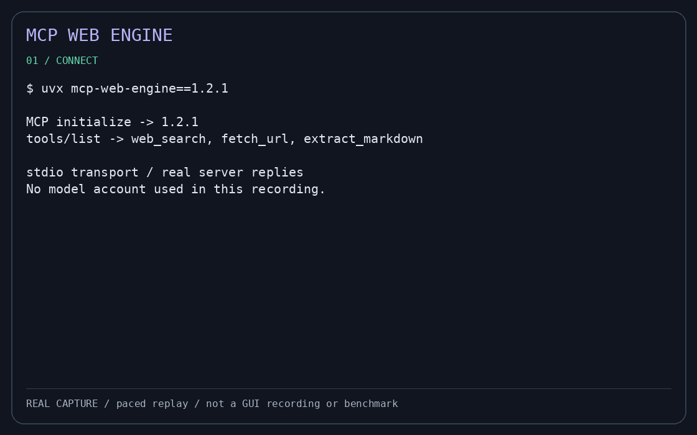

# MCP Web Engine

[](https://www.npmjs.com/package/mcp-web-engine)
[](https://pypi.org/project/mcp-web-engine/)
[](https://opensource.org/license/mit)

**Give your MCP client web search, public-page fetching and Markdown extraction through a self-hostable server.** For developers using Claude Desktop, Cursor, VS Code or their own MCP agents who want an operator-controlled SearXNG backend. Current release: **1.2.1**.

Use it to research a question and inspect its sources, fetch public documentation while coding, or turn a public article into Markdown for further analysis. It is not a browser automation service: authenticated pages and JavaScript rendering are outside its scope.

## Tools

| Tool | Arguments | Purpose | Example arguments |
|---|---|---|---|
| `web_search` | `query`, optional `limit` | Search through configured SearXNG | `{"query":"Model Context Protocol","limit":3}` |
| `fetch_url` | `url`, optional `max_bytes` | Fetch a public HTTP(S) page | `{"url":"https://example.com/"}` |
| `extract_markdown` | `url`, optional `max_bytes` | Convert fetched HTML to Markdown | `{"url":"https://example.com/"}` |

Use `tools/list` for authoritative schemas and bounds.

## Recorded demo (30–60 seconds)



This 35-second replay of **real tool execution** is paced for readability: not a Claude/Cursor UI recording and not a performance benchmark. It shows initialization, tool listing, a live search, public-page fetch and Markdown extraction using public release 1.2.1 over stdio. Replay duration is not execution time. See [the runnable demo](https://github.com/Arbolencio/mcp-web-engine/blob/master/examples/demo.py), [captured JSON exchange](https://github.com/Arbolencio/mcp-web-engine/blob/master/docs/assets/demo-session.json) and [replay renderer](https://github.com/Arbolencio/mcp-web-engine/blob/master/examples/render_demo.py). Recording requires a reachable SearXNG backend for search.

## Use cases

- **Research with sources:** search a topic, inspect result URLs and fetch the pages before summarizing.
- **Coding with public documentation:** give an agent current documentation text without requiring a browser session.
- **Prepare Markdown for analysis:** extract readable content from static public HTML for a downstream workflow; review source material before relying on it.

## Prerequisites

- Python **>=3.11** for the server.
- For npm: Node **>=18** (prefer a maintained release) and **[uv on PATH](https://docs.astral.sh/uv/getting-started/installation/)**. npm installs a launcher, not Python or SearXNG; uv can provision Python.
- A reachable, operator-controlled **SearXNG instance with JSON search enabled** for `web_search`. The examples use `http://127.0.0.1:8082/search`; change this to your backend. SearXNG is not bundled. Initialization, tool listing and public-page fetch/extraction do not require SearXNG.
- An MCP-capable client with local stdio support. Approve tools according to your client's trust controls.

Installation resolves Python dependencies and may access package indexes. uv isolates dependencies; it is not a security sandbox. Search queries go to SearXNG and its upstream engines; see [security and privacy](#security-controls-and-limitations).

## npm quick start

Use this when you want an MCP server without cloning the repository. Requirements: Node >=18 (prefer a maintained Node release), **uv on PATH**, Python >=3.11 (uv can provision it), and a reachable SearXNG instance with JSON search enabled. npm installs the launcher; it does **not** bundle Python or SearXNG. Install uv from [its official instructions](https://docs.astral.sh/uv/getting-started/installation/).

Launch the pinned npm release (it waits for a stdio client):

```bash
npx --yes mcp-web-engine@1.2.1
```

For actual agent use, paste this into your MCP client's server configuration and replace the SearXNG URL with yours:

```json
{
  "mcpServers": {
    "mcp-web-engine": {
      "command": "npx",
      "args": ["--yes", "mcp-web-engine@1.2.1"],
      "env": {
        "SEARXNG_URL": "http://127.0.0.1:8082/search",
        "ALLOW_DDG_FALLBACK": "false"
      }
    }
  }
}
```

Ready-to-copy files: [Linux/macOS](examples/npm-stdio.json) and [Windows](examples/npm-stdio.windows.json). On Windows the example uses `cmd /c npx` for the npm command shim. The stdio server waits for a client: silence after manually running `npx --yes mcp-web-engine@1.2.1` is normal, not a chat prompt. Initialization lists three tools; a working search backend is needed only when you search. First launch may access package indexes.

**If setup fails:** check `node --version` and `uv --version` in the environment used by the client. Desktop clients may not inherit your interactive shell's PATH; supply the absolute executable path if needed. If tools appear but search fails, verify SearXNG's `/search?q=test&format=json` endpoint returns JSON, not an HTML page or a disabled-JSON error. Local stdio does not need an HTTP API key.

### Connect your client

**Claude Desktop**

1. Open **Settings → Developer → Edit Config** to locate `claude_desktop_config.json`.
2. Merge the `mcpServers` entry above into that file (do not overwrite existing servers). Use [the Windows configuration](examples/npm-stdio.windows.json) on Windows or [Linux/macOS configuration](examples/npm-stdio.json) elsewhere.
3. Save, fully restart Claude Desktop and check the available tools. Ask it to search a topic with `web_search`, then fetch a public result with `fetch_url` or `extract_markdown`; approve calls when prompted.

See the [official local-server guide](https://modelcontextprotocol.io/quickstart/user).

**Cursor**

1. Create `.cursor/mcp.json` in your project, or use `~/.cursor/mcp.json` for your user-wide setup.
2. Merge the same `mcpServers` configuration above, choosing the Windows example where appropriate.
3. Open Cursor's MCP settings, enable/reload the server, and check its tool list. In Agent, request a search and approve tool execution if prompted.

See [Cursor's official MCP documentation](https://cursor.com/docs/mcp).

**VS Code**

1. Copy [examples/vscode-mcp.json](examples/vscode-mcp.json) to your workspace's `.vscode/mcp.json`; on Windows use [examples/vscode-mcp.windows.json](examples/vscode-mcp.windows.json).
2. Set your SearXNG URL. VS Code uses a top-level **`servers`**, not `mcpServers`, and each entry explicitly sets `"type": "stdio"`. Do not paste the Claude/Cursor JSON unchanged.
3. Use **MCP: List Servers** in the Command Palette to start the server, review the trust prompt, then enable its tools in agent chat. Request a search and inspect the tool result.

See [VS Code's official MCP documentation](https://code.visualstudio.com/docs/agent-customization/mcp-servers). Client versions and organization policies can change available controls.

**Verification scope:** installed npm stdio command shims were tested on Windows/macOS/Linux with Node 18/22. Configuration examples are schema checked; no full end-to-end GUI sessions in Claude Desktop, Cursor or VS Code were tested. A successful stdio smoke test is not proof of a graphical client's integration.

### PyPI installation (without npm)

Use an isolated virtual environment rather than installing into an externally managed system Python (PEP 668):

```bash
python -m venv .venv
# Linux/macOS:
. .venv/bin/activate
# Windows PowerShell instead: .venv\Scripts\Activate.ps1
python -m pip install "mcp-web-engine==1.2.1"
mcp-web-engine --version
```

In your client configuration, replace `command` with the absolute path to `.venv/bin/mcp-web-engine` (Windows: `.venv\Scripts\mcp-web-engine.exe`) and use `"args": []`; keep the backend environment settings. Escape Windows backslashes as `\\` inside JSON. This route needs Python and pip, not Node or uv. The same SearXNG requirements apply. Alternatively, with uv installed: `uvx --from mcp-web-engine==1.2.1 mcp-web-engine`.

## Local stdio

```bash
git clone https://github.com/Arbolencio/mcp-web-engine.git
cd mcp-web-engine
uv run --locked mcp-web-engine
```

CLI accepts `--stdio` (default), `--serve`, or its `--sse` alias as mutually exclusive transport choices. Use `mcp-web-engine --help` for usage and `mcp-web-engine --version` for the installed version; unknown flags are rejected.

Default transport is newline-delimited JSON-RPC over stdin/stdout. Diagnostics and installer output belong on stderr. Clients should initialize, send `notifications/initialized`, then use `ping`, `tools/list`, and `tools/call`. No search service is required for initialization or listing tools.

Client configuration (replace the absolute checkout path):

```json
{
  "mcpServers": {
    "mcp-web-engine": {
      "command": "uv",
      "args": ["tool", "run", "--from", "/absolute/path/mcp-web-engine", "mcp-web-engine"],
      "env": {"SEARXNG_URL": "http://127.0.0.1:8082/search", "ALLOW_DDG_FALLBACK": "false"}
    }
  }
}
```

For a pinned public installation use `uvx --from mcp-web-engine==1.2.1 mcp-web-engine` or `npx --yes mcp-web-engine@1.2.1`. These pin the project version, not its transitive dependencies. The clone above follows the repository default branch, not a release pin; use a reviewed commit and `uv sync --locked` for source deployments.

The npm tarball includes the canonical Python src package and build metadata. `npx --package /absolute/path/mcp-web-engine-1.2.1.tgz mcp-web-engine` delegates to uv; Python/uv remain prerequisites, and first launch may need network access for dependencies.

## HTTP

```bash
export API_KEY="$(python3 -c 'import secrets; print(secrets.token_urlsafe(32))')"
export SEARXNG_URL=http://127.0.0.1:8082/search
uv run mcp-web-engine --serve
```

HTTP defaults to `127.0.0.1:5050`; `API_KEY` must contain at least 32 non-whitespace characters. Send `Authorization: Bearer <YOUR_API_KEY>` to protected endpoints. Keep the key out of source control and URLs. `/health` is a liveness endpoint, not a SearXNG connectivity check.

`POST /v1/mcp/legacy` provides the initialize-based compatibility path. `/v1/mcp` is a project-specific stateless extension requiring `Mcp-Method` (and `Mcp-Name` for tool calls). Its `2026-07-28` label is an internal extension identifier, **not a claim of official MCP conformance**. SSE support is limited; this is not a complete implementation of every MCP transport or optional feature.

## Configuration

Process environment is authoritative. CWD `.env` files are **not** loaded automatically. To explicitly load one, set `MCP_WEB_ENGINE_ENV_FILE` to an existing **absolute** file path; process variables override file values.

| Variable | Default | Meaning |
|---|---|---|
| `SEARXNG_URL` | `http://127.0.0.1:8082/search` | Trusted operator-controlled search backend; search needs it running |
| `ALLOW_DDG_FALLBACK` | `false` | Opt in to sending queries to DuckDuckGo if SearXNG fails |
| `API_KEY` | empty | Operator-generated HTTP bearer key; mandatory for CLI HTTP mode |
| `HOST` / `PORT` | `127.0.0.1` / `5050` | HTTP bind address and port |
| `RATE_LIMIT_PER_MINUTE` | `120` | Per-key HTTP admission limit, persisted in local SQLite |
| `DEFAULT_TIMEOUT_SEC` | `10` | Outbound timeout, up to 120 seconds |
| `MAX_PAYLOAD_BYTES` | `2097152` | Payload ceiling, up to 16 MiB |
| `MAX_CONCURRENT_REQUESTS` | `16` | Process-local ceiling on in-flight HTTP requests; not a multi-worker global limit |
| `REQUEST_BODY_TIMEOUT_SEC` | `10` | Absolute HTTP request-body read deadline in seconds, not a timeout reset by each chunk |
| `MCP_WEB_ENGINE_STATE_DB` | `$XDG_STATE_HOME/mcp-web-engine/usage.sqlite3` (or `~/.local/state/...`) | Local SQLite admission quotas and per-key tool telemetry; share one local file across workers |
| `MCP_WEB_ENGINE_BETA_KEYS_FILE` | Same state directory, `beta_keys.json` | Operator-managed credentials, separate from telemetry; use an absolute path |
| `LOG_LEVEL` / `ENV` | `INFO` / `production` | Logging and environment settings |

## Docker

```bash
# With API_KEY already exported as above:
docker compose up --build -d
```

The image installs the Python package, runs as a non-root user and explicitly starts `mcp-web-engine --serve` on port 5050. Compose publishes **only host loopback**. Container `HOST=0.0.0.0` is necessary for that port mapping; do not confuse it with the host binding. Set `SEARXNG_URL` to a reachable backend: compose defaults to `http://host.docker.internal:8082/search`, using the host gateway. An instance bound only to host loopback may not be reachable from Docker. No SearXNG instance or credentials are bundled. See [operations and limitations](docs/operations.md).

## Security controls and limitations

Public fetches validate schemes, resolved addresses and redirects, rejecting loopback/private/reserved destinations. Bounded payloads, timeouts and tool argument validation reduce resource exposure. These are defense-in-depth controls, not a guarantee against all SSRF, DNS, routing, proxy or upstream failures; enforce outbound network policy independently.

SearXNG is an intentional trusted-backend exception to public-fetch restrictions and can use a private address. Its operator and upstream engines receive queries; self-hosting does not keep searches entirely on-host. DuckDuckGo fallback is off by default, but ordinary SearXNG searches still involve upstream services. Fetched pages are untrusted input and may contain prompt injection. Dependency isolation does not isolate filesystem/network access. HTTP authentication is not TLS or a multi-host distributed rate limiter; use a restricted network and a TLS reverse proxy when needed. Do not expose the service directly to the Internet.

HTTP mode persists admission counters and tool telemetry keyed by hashed key IDs in local SQLite; operator-managed JSON credentials are stored separately. Self-hosting is not a promise of no logging or no disk writes: review logging, state paths, retention and filesystem permissions before handling sensitive workloads. See [operations and limitations](docs/operations.md).

## Development and artifact verification

```bash
uv sync --locked --extra test
uv run --locked pytest -q
uv run --with build python -m build
npm pack
python3 tests/artifact_smoke.py -- uv tool run --from /absolute/path/to/package.whl mcp-web-engine
```

Tests are offline by default. The artifact smoke sends no search query: initialize, silent notification, ping, tool listing, and a rejected loopback fetch. CI tests Python 3.11–3.13 and builds/installs wheel and npm artifacts outside the checkout. Package dependency installation still requires package-index access unless cached.

## License

MIT License. See [LICENSE](LICENSE).
